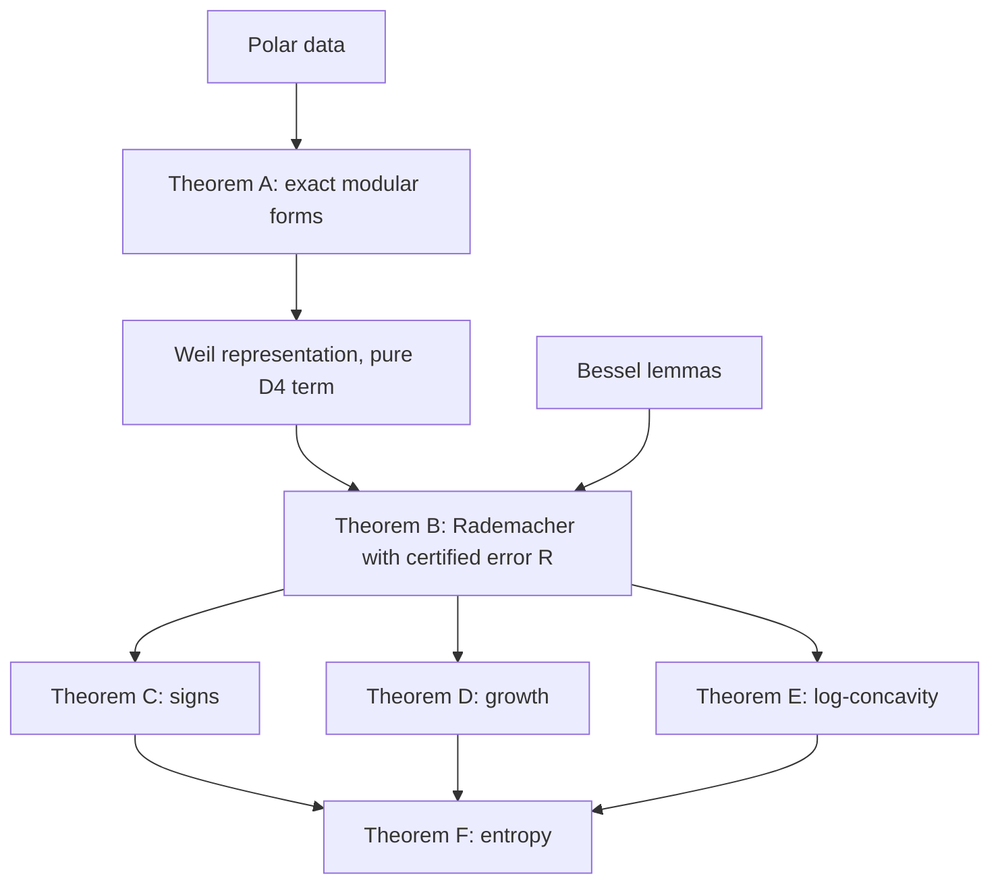
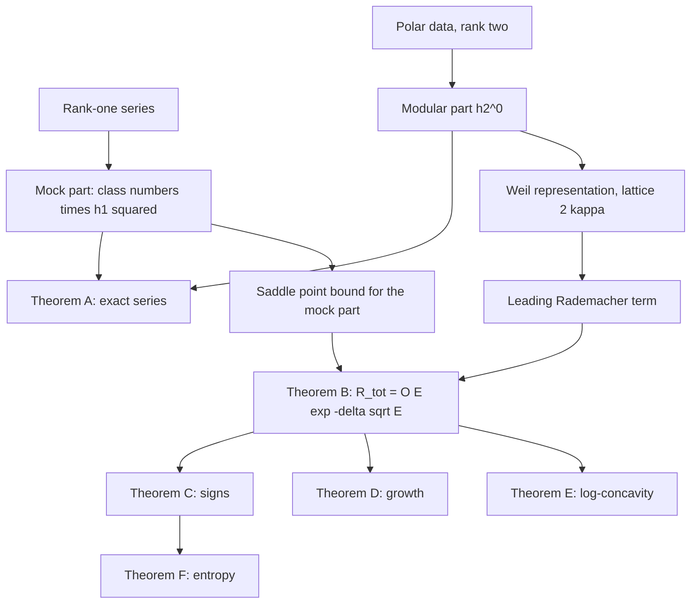

# Signs of D4-D2-D0 black hole indices

Code and computation logs for the series *Signs of D4-D2-D0 Black Hole Indices*.

The Abelian D4-D2-D0 indices of a one-parameter Calabi-Yau threefold count the microstates of
Maldacena-Strominger-Witten black holes with one unit of D4-brane charge. Their generating series is a
vector-valued modular form of weight -3/2. With two units of D4-brane charge the generating series is mock
modular of depth one. This repository proves, for every charge, the sign, the growth and the log-concavity of
these indices, and the black hole entropy with a certified error.

## Part I: the hypergeometric threefolds (`part1/`)

Models: X5, X6, X8, X10, X4,3, X6,4, X3,3, X4,4, X6,6, X6,2, X4,2. Polar coefficients from
Alexandrov-Feyzbakhsh-Klemm-Pioline-Schimannek, *Quantum geometry, stability and modularity*,
Commun. Number Theory Phys. 18 (2024) 49-151.

| Result | What is computed | Log |
|---|---|---|
| Theorem A (exact construction) | each series as an exact rational combination of `E4^a E6^b D^l theta / eta^N`; agreement with all 161 published non-polar coefficients | `construction.log` |
| S-matrix | `h(-1/tau) = (-i tau)^{-3/2} eps kappa^{-1/2} cos(2 pi mu nu/kappa) h(tau)`, `eps = (-1)^{chi_D+1}`, checked to 1e-29 | `smatrix.log` |
| Theorem B (Rademacher with certified error) | `|c/L - 1| < R` certified at 2097 pairs | `certify_error.log`, `rademacher_c1.log` |
| Theorem C (signs) | `R < 1` certified from the threshold on; exact signs below it; 18 negative first non-polar coefficients | `rigorous.log`, `tab_exc.txt` |
| Theorem D (growth) | analytic threshold certified in ball arithmetic; exact checks below it | `rigorous.log` |
| Theorem E (log-concavity) | analytic threshold certified; exact checks below it | `logconcave.log` |
| Extended data | integrality, positivity, growth, log-concavity for n <= 200; higher-order Turan inequalities | `extended_200.log`, `turan.log` |
| Tables and figure data | thresholds, constants, worked examples, error curves | `tab_*.txt`, `*.dat` |

All exact computations use rational arithmetic (FLINT); all real inequalities are certified in
midpoint-radius ball arithmetic (Arb, 256 bits).

### Reproduce

```sh
pip install python-flint==0.9.0 mpmath
./part1/run_all.sh      # about 15 seconds
```



## Part II: two units of D4-brane charge (`part2/`)

Models: X10 and X8. Rank-two series from Alexandrov-Feyzbakhsh-Klemm-Pioline, *Mock modular
Donaldson-Thomas invariants and the threefold X10, X8*, Commun. Number Theory Phys. 20 (2026) 97-148.
The series is `h2 = h2^(0) + h2^(an)`: a weakly holomorphic form of weight -3/2 plus Hurwitz class number
series multiplied by the square of the rank-one series.

| Result | What is computed | Log |
|---|---|---|
| Theorem A (exact construction) | rational and integer rank-two series; agreement with all 88 published coefficients | `x10r2.log`, `x8r2.log`, `published2.log` |
| S-matrix | modular part of rank two (lattice 2 kappa, sign `(-1)^(chi_2D+1)`) and rank one, checked to 1e-39 | `smatrix2.log` |
| Theorem B (two-term Rademacher bound) | `R_tot = R_hat + (M* + I*)/L_hat`, mock part bounded by a saddle point estimate; constants K, K_G, merger gap delta | `rigorous2.log` |
| Theorem C (signs) | every index with q0 <= -2 positive; exactly five negative indices with -2 < q0 <= 0 | `signs2.log`, `signs2c.log`, `tab_exc.txt` |
| Theorems D, E (growth, log-concavity) | analytic thresholds certified in ball arithmetic; exact checks below them; integrality for n <= 415 | `growth2.log` |
| Higher-order Turan | checked for n <= 393 | `turan2.log` |
| Tables and figure data | thresholds, constants, examples, error curves | `tab_*.txt`, `*.dat` |

### Reproduce

```sh
./part2/run_all.sh      # about 20 seconds
```



## License

MIT (see `LICENSE`).
